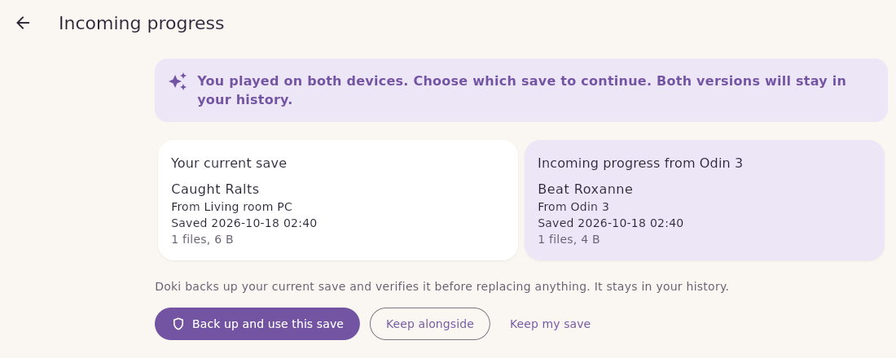
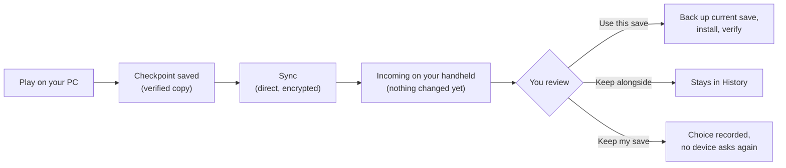

<h1 align="center">doki</h1>

<p align="center">
  <strong>Carry your game saves between devices, with history, without ever losing progress.</strong>
</p>

<p align="center">
  <a href="https://github.com/drluciano/doki/actions/workflows/rust.yml"></a>
  <a href="https://github.com/drluciano/doki/actions/workflows/app.yml"></a>
  
  
</p>

<p align="center">
  <a href="#quick-start">Quick start</a> ·
  <a href="https://github.com/drluciano/doki/wiki">Wiki</a> ·
  <a href="docs/spec/safety-contract.md">Safety contract</a> ·
  <a href="CONTRIBUTING.md">Contributing</a>
</p>

Doki is a save handoff tool for emulators. Play on your PC, pick up on your handheld, and come back again. Every save you hand off is kept as a **checkpoint** in a version history, and progress from another device **never replaces your current save until you choose it**.

Syncing a save and using it are separate actions. When progress arrives from another device it waits in **Incoming**, where you can review it and then **use it**, **keep it alongside** your own, or **keep your save**. If you played on both devices, Doki tells you, and both versions stay in your history whichever you pick.

<p align="center">
  
</p>

## Contents

- [Features](#features)
- [How it works](#how-it-works)
- [Project status](#project-status)
- [Quick start](#quick-start)
- [Building from source](#building-from-source)
- [Documentation](#documentation)
- [Repository layout](#repository-layout)
- [Contributing](#contributing)
- [Security](#security)
- [License](#license)

## Features

- **Checkpoints.** Each checkpoint is an exact, verified, unchangeable copy of a game's save files. If nothing changed since the last one, Doki says so instead of storing a duplicate.
- **Automatic checkpoints.** Doki watches your save folders and makes a checkpoint once a save has stopped changing for 30 seconds. On Android it keeps working in the background; on Windows it lives in the tray and can start with Windows.
- **Whole emulators.** Add an emulator's save folder once and every game in it is tracked on its own, including games you start later.
- **Review before anything changes.** Received progress waits in Incoming. Doki compares it with your save and explains how they relate: newer than yours, older, from a different playthrough, or "you played on both devices".
- **Back up, then replace.** **Use this save** and **Restore a checkpoint** first verify a backup of your current save, re-check that you have not played since the review, then install and verify the new files.
- **Nothing is lost by choosing.** Picking one version keeps the other in History as *Separate progress*, ready to restore.
- **Recovery you control.** If an install is interrupted (power loss, storage pulled), the game is blocked until you choose **Finish the change** or **Put my save back**. Doki never guesses.
- **Device to device, no account.** Pair devices with a short code on the same Wi-Fi or a long code from anywhere. Devices talk directly over an end-to-end encrypted connection, with no host and no sign-up, much like Syncthing.
- **Optional self-hosted relay** for devices that are rarely online at the same time. It stores only encrypted packages and never decides anything.
- **A handoff file** works too, if you would rather move saves on a USB stick or by email.
- **You decide what is kept.** Checkpoints are kept forever by default. Delete one, or choose **Keep checkpoints for** a set time; Doki previews what goes and always keeps the newest of each game, current saves and pinned checkpoints.
- **A library that looks like yours.** Game covers and banners from SteamGridDB (with your own free key) or your own images, Light, Dark and OLED themes, notifications, and full keyboard and controller support.
- **App and command line.** A Flutter app for Android and Windows, and a `doki` command that drives the same engine.

## How it works



Doki decides how two saves relate by their **ancestry** (which checkpoint each one continued from), never by timestamps or file sizes, so a wrong clock cannot make it pick the wrong save. A save is mostly binary data, so Doki never tries to merge two of them: you choose a whole version, and the other one is kept.

The rules behind this are written down in the [safety contract](docs/spec/safety-contract.md), and every step of an install is tested against interruption.

## Project status

Doki is **pre-release**. The engine, command line, app, Android bridge and device pairing are built and tested in CI. Use copies of your saves until a release is published.

| Platform | Status |
|---|---|
| Windows | App and CLI build and pass tests in CI. Runs from the tray. Test builds available. |
| Android | App builds in CI (arm64, x86_64) with a background watcher. The save-folder adapter uses Android's folder picker and is **experimental** until it is verified on real hardware. Updating currently needs an uninstall (see below). |
| Linux | Used for development. App and CLI run; not a release target yet. |
| macOS, iOS | Not supported. |

> **Known issue:** each Android test build is signed with a different key, so a newer APK will not install over an older one, and uninstalling deletes Doki's checkpoints on that device ([#82](https://github.com/drluciano/doki/issues/82)). Sync with another device before updating; [Updating Doki](https://github.com/drluciano/doki/wiki/Updating-Doki) has the steps. Your emulator's own save files are not affected.

Not built yet: the practice tutorial with sample saves, QR codes, and encrypted handoff files. Doki makes no claim about a specific emulator until a full restore has been tested on a real device. See [Roadmap and status](https://github.com/drluciano/doki/wiki/Roadmap-and-Status) for details.

## Quick start

### The app

1. Download a test build from the latest successful [App workflow run](https://github.com/drluciano/doki/actions/workflows/app.yml): `doki-windows` (a folder with `doki.exe`) or `doki-android` (a debug-signed APK). These are test builds, not releases.
2. Name the device, then **Library → Add game** and choose the game's save folder, or choose **Whole system** for an emulator's whole save folder. Connecting a folder changes nothing.
3. Play. Once the save settles, Doki makes a checkpoint on its own. Keep Doki running in the background (Android) or the tray (Windows).
4. Under **Devices**, choose **Show a code on this device**, and enter the code on your other device.
5. Progress from the other device appears in **Incoming**. Open it to review, then choose what to do.

The [Getting started](https://github.com/drluciano/doki/wiki/Getting-Started) wiki page walks through this with more detail.

### The command line

Requires Rust 1.91 or newer.

```sh
cargo build --release
./target/release/doki init --name PC
./target/release/doki add "Pokémon Emerald" "C:\path\to\emulator\saves"
./target/release/doki capture "Pokémon Emerald" --closed   # or: doki watch

# Pair with your other device and sync directly
./target/release/doki devices invite        # on this device
./target/release/doki devices join CODE     # on the other device
./target/release/doki devices sync

# On the device that received progress
./target/release/doki incoming
./target/release/doki use "Pokémon Emerald" <checkpoint>
```

Every command is listed in the [command line reference](docs/cli.md).

## Building from source

| Component | Needs | Build and test |
|---|---|---|
| Engine and CLI | Rust 1.91+ | `cargo test --workspace` |
| Desktop app | Rust, Flutter 3.47 | `tools/app-test.sh`, then `cd app && flutter run -d windows` |
| Android app | Rust Android targets, `cargo-ndk`, Android SDK and NDK | `tools/build-android-engine.sh`, then `cd app && flutter build apk` |
| Relay server | Rust, or Docker | `cargo build --release -p doki-relay` |

Full instructions are in [docs/app.md](docs/app.md) and on the [Building from source](https://github.com/drluciano/doki/wiki/Building-from-Source) wiki page.

## Documentation

**For players**, the [wiki](https://github.com/drluciano/doki/wiki) covers getting started, automatic checkpoints, whole emulators, game art, pairing devices, reviewing incoming progress, restoring checkpoints, freeing up space, settings and notifications, updating, recovering an interrupted change, troubleshooting and a glossary. The app has the same how-tos under **Settings → Help and how-tos**.

**Reference**, in this repository:

| Document | What it covers |
|---|---|
| [Safety contract](docs/spec/safety-contract.md) | What Doki guarantees, every state, and what happens after an interruption |
| [App](docs/app.md) | Using and building the Flutter app, and what is verified |
| [Command line](docs/cli.md) | Every `doki` command and exit code |
| [Device-to-device sync](docs/peer.md) | Pairing codes, trust, and how direct sync works |
| [Relay](docs/relay.md) | Running the optional self-hosted relay and its security model |
| [Open questions](docs/spec/open-questions.md) | Defaults chosen where a decision is still open |
| [Engineering plan](docs/engineering.md) and [design](docs/design.md) | Architecture and product design |

The wiki pages live in [`docs/wiki`](docs/wiki) and are published to the GitHub wiki when they change on `main`.

## Repository layout

```
crates/
  doki-core       domain model: checkpoints, ancestry, errors (no I/O)
  doki-vault      local content-addressed store
  doki-platform   save-folder adapters
  doki-engine     capture, review, install with verified backup, recovery
  doki-peer       device-to-device pairing and sync (iroh)
  doki-sync       relay client and encryption
  doki-relay      self-hostable relay server
  doki-cli        the doki command
  doki-api        JSON command interface for non-Rust front ends
  doki-ffi        C ABI for the desktop app
  doki-jni        JNI bridge for Android
app/              Flutter app (Android, Windows, Linux)
android/bridge/   Java side of the Android bridge
docs/             specification, guides and wiki sources
tools/            build and test scripts
```

## Contributing

Contributions are welcome. Read [CONTRIBUTING.md](CONTRIBUTING.md) and the [safety contract](docs/spec/safety-contract.md) first. In short:

- Run `cargo fmt --all -- --check`, `cargo clippy --workspace --all-targets -- -D warnings` and `cargo test --workspace` before opening a pull request, and `tools/app-test.sh` if you changed the app.
- Any code that writes save files goes through the journaled install, with a crash-point test for each new step.
- Use synthetic test saves. Never commit real saves, ROMs or credentials.

## Security

Saves stay on your devices. Direct sync is end-to-end encrypted and authenticated with per-device keys; the relay stores only encrypted packages. Handoff files are **not** encrypted yet, so move them only over channels you trust. Details are in [peer.md](docs/peer.md) and [relay.md](docs/relay.md).

If you find a security problem, please report it privately to the maintainer ([@drluciano](https://github.com/drluciano)) rather than in a public issue.

## License

A license has not been chosen yet, so no permission to use, copy or redistribute this code is granted beyond what GitHub's terms allow. This will be settled before the first release.
