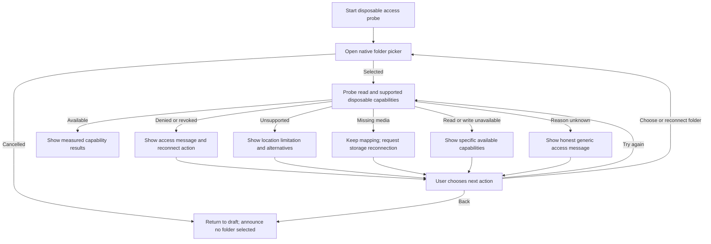

# F01 / issue 12: filesystem access feasibility design handoff

Status: proposed research-spike handoff. Owner-reported first Android target is Eden 0.2.1 on an AYN Odin 3 running Android 15; Windows build details and second emulator targets are pending. This document does not change issue 12 acceptance scope, approve mockups, or imply a production UI exists. The feasibility spike produces observed platform results and a tested adapter contract; production visual UI is not implemented by this spike.

## Scope and evidence

Use the issue's agreed device/platform matrix when supplied. Until then mark device-specific outcomes **Not tested**, never supported by assumption. Record OS version, device, emulator/profile, location/provider, access mode, reproduction steps, and actual result. Distinguish observed behavior from a proposed interface contract. Native platform pickers and grants govern access; Doki must not promise access outside them.

Test adapters using a disposable fixture bundle, never a user's real save. Include two related files and a known hash manifest. Read probes must not mutate the fixture. Any write/rename probe requires an explicitly designated disposable probe location and records actual capabilities independently. Read success does not imply write, rename, atomic replacement, or durable permission. Missing media must not be interpreted as intentional deletion.

## Proposed interface contract to validate

Return a typed result from each discovery/probe/revalidation operation. Proposed fields: `status`, `platformReason` (optional sanitized details), `canRead`, `canWrite`, `canCreate`, `canRename`, `canReplaceAtomically`, `grantPersistence`, `retryable`, and `suggestedAction`. Capability values support `unknown`; unavailable evidence must not become `false` or `true` silently. An adapter should distinguish operationally meaningful outcomes where the OS permits it; otherwise use `unavailable_unknown` with honest copy rather than guessing a cause.

| Outcome | Required observable behavior | Plain-language message / action |
| --- | --- | --- |
| `user_cancelled` | No mapping created; keep non-sensitive draft metadata; no error banner | “No folder selected.” / Choose folder |
| `permission_denied` | No read/write attempt beyond allowed probe; no retry loop; no playable-file mutation | “Doki doesn't have access to this folder.” / Choose folder again |
| `unsupported_location` | Preserve draft; report evidence/profile limitation; do not imply system restrictions can be bypassed | “This location isn't available to Doki.” / Choose another location; Show supported options |
| `media_missing` | Preserve mapping, vault, and history; block operations requiring source; no deletion proposal | “Your save location isn't connected.” / Reconnect storage; Try again |
| `read_unavailable` | Stop capture; no selectable incomplete checkpoint; keep source/history | “Doki couldn't read this save.” / Try again; Choose folder again |
| `write_unavailable` | Report read capability separately; block apply/write probes outside fixture | “Doki can read this folder but can't write to it.” / Choose another location; View details |
| `grant_revoked` | Existing mapping remains visibly disconnected; require native reauthorization | “Folder access needs updating.” / Reconnect folder |
| `unavailable_unknown` | Do not assert denial, missing media, or corruption without evidence | “Doki can't access this location right now.” / Try again; Choose folder again; View details |
| `available` | Report independently measured capabilities and tested grant lifetime; no production-support claim | “Folder access checked.” / View test results |

Labels distinguish “Choose folder again” (new picker selection) from “Try again” (repeat revalidation). If the platform cannot differentiate revocation from denied access, show generic access copy and document the ambiguity. Recoverable access errors must not erase setup input, remove history, or initiate replacement. A read-only location may permit checkpoint capture in a future product story; this spike merely reports capability and does not invent a new acceptance requirement.

## Accessible flow model

For any minimal probe harness, provide programmatic labels, logical keyboard/focus order, and text results instead of color-only statuses. Announce a final outcome once; do not announce every file operation. Native picker cancellation returns focus to its initiating control. Error results retain focus on a persistent outcome heading or originating control with an accessible announcement; avoid unexpected dialogs and retry loops. Long provider names/paths wrap or expand without hiding action labels. These requirements describe an accessible test flow, not production screen mockups.

## Test scenarios and report format

Record each scenario as Pass, Fail, Blocked, or Not tested, with observed status and evidence location:

1. Cancel selection and re-open; confirm no access or mapping inferred.
2. Deny access where the platform offers denial; verify bounded error and retry action.
3. Select a platform-restricted/unsupported location if observable; document picker exclusion if selection cannot occur.
4. Read a disposable multi-file fixture; compare contents and hashes without source mutation.
5. Probe read-only and designated writable disposable locations independently; record create/write/rename support and failures.
6. Revoke a grant, then revalidate; preserve existing mapping and distinguish cause only when supported.
7. Disconnect removable media/provider, revalidate, reconnect, and retry; verify no deletion interpretation.
8. Restart the harness/app and, if in scope, device; revalidate persistence rather than assuming it.
9. Inject an unavailable/unknown provider result and confirm honest fallback behavior.

Existing issue acceptance criteria remain authoritative. If a scenario needs unavailable hardware or exceeds that scope, record the limitation and proposed follow-up rather than expanding the story or declaring completion. Final evidence should state precisely which capabilities and devices were tested, which remain unknown, and any implications for later capture/apply designs.
