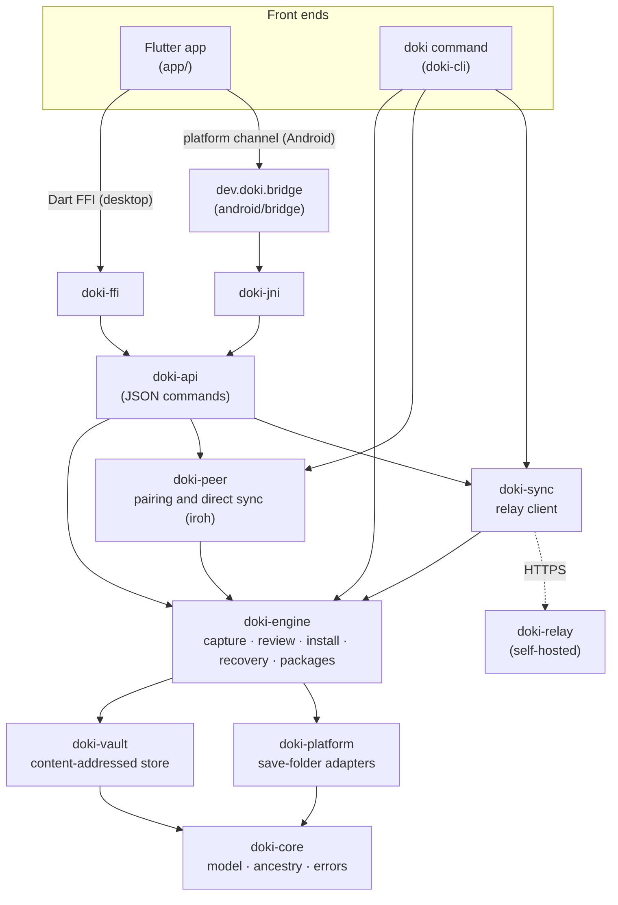

# Architecture

Doki is one repository: a Rust engine that holds every safety rule, thin front ends that call it, and adapters that read and write save folders on each platform.

## Layers

| Crate or folder | Responsibility |
|---|---|
| `doki-core` | Checkpoints, path rules, ids, ancestry and error codes. No I/O. |
| `doki-vault` | The local store: files stored once by SHA-256, immutable checkpoint records, per-game records, OS locks. |
| `doki-platform` | The `SaveLocation` trait for save folders, the local-folder adapter, `MemberLocation` (one game inside a whole-system folder) and fault injection for tests. |
| `doki-engine` | Capture, review, the journaled install, recovery and handoff packages. Every write to a save folder goes through `install.rs`. |
| `doki-peer` | Per-device Ed25519 identity, trusted device book, pairing codes, LAN discovery and QUIC sessions over iroh. |
| `doki-sync`, `doki-relay` | The optional relay: client with XChaCha20-Poly1305 sealing, and the server. |
| `doki-api` | One JSON request per action, used by every non-Rust front end. |
| `doki-ffi`, `doki-jni`, `android/bridge` | C ABI for desktop, JNI for Android. On Android, Java supplies the save folder through the Storage Access Framework. |
| `app/` | The Flutter UI. It holds no safety logic: every action is one engine request. |

## Key ideas

- **Delivery is separate from activation.** Sync and receive write only to the vault. Only the install procedure writes save folders.
- **Ancestry, not time.** Each checkpoint lists its parents. How two saves relate is computed from that graph. Choices are recorded as *choice checkpoints* with two parents, so other devices see the decision and do not raise it again.
- **Journaled install.** Recheck, verified backup, journal, stage, replace, verify, commit. An interruption at any step has a defined outcome and a recovery path. Each adapter states how it replaces a file (rename-over on desktop, delete-then-rename on Android) and installs are refused when that is unknown.
- **Honest errors.** Every error code says whether the save may have changed.

Read the [safety contract](https://github.com/drluciano/doki/blob/main/docs/spec/safety-contract.md) for states, steps and interruption outcomes, and the [engineering plan](https://github.com/drluciano/doki/blob/main/docs/engineering.md) for background.
