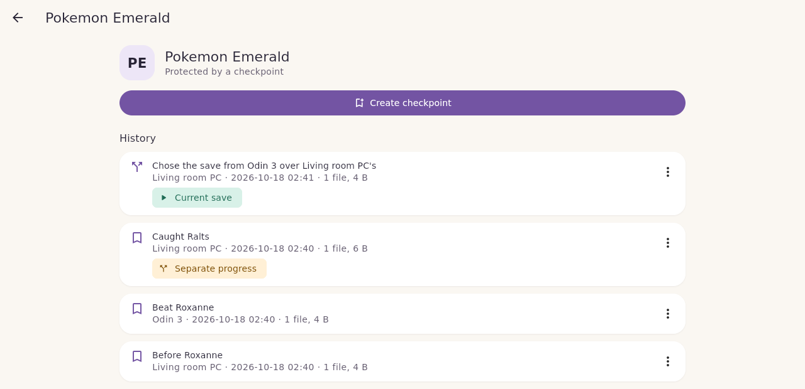

# History and restoring

Every game has a history: each checkpoint you created, each one that arrived from another device, and the backups Doki made before replacing your save. Nothing in it is ever changed after it is made.

## Reading the history

Open a game from **Library** to see its history, newest first. Each entry shows its label, the device it came from, when it was saved and how many files it holds.

| Label | Meaning |
|---|---|
| **Current save** | The checkpoint your save folder matches right now. |
| **Separate progress** | A version you set aside when you chose another one, or progress nobody continued from. Kept so you can go back to it. |
| Backup before a change | The copy Doki verified before replacing your save. |
| "Chose the save from … over …'s" | The record of a choice you made, so other devices do not ask again. |
| New progress not in a checkpoint yet | You have played since the last checkpoint. Create one to protect it. |

## Restore a checkpoint

1. Close the game in the emulator.
2. Open the checkpoint's menu and choose **Restore this checkpoint**.
3. Confirm with **Back up and restore**.

Restoring works exactly like using incoming progress: Doki verifies a backup of your current save first, then installs and checks the chosen checkpoint. Your previous save is kept in History.

## Other actions

- **Pin (keep forever)** protects a checkpoint from any future cleanup. Today Doki never deletes checkpoints automatically, but pins are kept for when cleanup arrives.
- **Copy the files out**: on the command line, `doki export-files` writes a checkpoint's files to any folder without touching your save. The app does not offer this yet.

## Storage

Doki stores each distinct file once, so checkpoints of a save that barely changed take little extra space. There is no automatic cleanup yet. See [Roadmap and status](Roadmap-and-Status.md).
