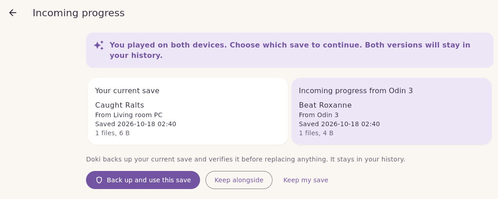

# Reviewing incoming progress

When another device sends progress, Doki stores it and shows it under **Incoming**. It does not touch your save. You decide what happens next.

## Open the review

Choose the game under **Incoming**. Doki checks the received copy again, then shows **Your current save** next to **Incoming progress from …**, with where each came from and when it was saved.

If your save has changed since your last checkpoint (you played after creating it), Doki first makes a checkpoint of it, so your latest progress is part of the comparison and of the backup. You will see **Your latest progress was saved first**.

At the top, Doki tells you how the two saves relate:

| Doki says | What it means |
|---|---|
| *Device* continued from your current save | The incoming save continues from yours. Using it moves you forward. |
| **You played on both devices** | Both saves continued from the same checkpoint in different directions. Choose which one to continue. Both stay in your history. |
| These saves started separately | They come from separate starts, for example two different playthroughs. Doki never assumes one is newer. Both stay in your history. |
| This is the first save for this game on this device | You have no checkpoint here yet. |
| Some history has not arrived yet | Doki cannot tell how they relate yet. It does not guess. Sync again, or review carefully. |
| This is already your current save / This is older than your current save | Nothing to do. |

Doki works this out from the history of each save (which checkpoint it continued from), never from clocks, file sizes or file dates.

## Your choices

### Back up and use this save

1. Doki confirms you have not played since the review. If you have, it saves that progress as a checkpoint and asks you to review again (**You played since reviewing**).
2. It verifies a backup of your current save.
3. It copies the incoming save into place and checks every file.

You will see **Now using this save**. Your previous save stays in History and can be restored any time.

Close the game in the emulator before you choose this.

### Keep alongside

Files the incoming progress in History and stops asking about it. Nothing changes. You can restore it later from History.

Because this does not record a decision, a device may offer the same progress again later.

### Keep my save

Keeps your current save and records that choice. The other version stays in History. Your other devices learn about the choice when they sync, and none of them asks about it again.

## A game that is not set up here yet

If progress arrives for a game this device does not have, Incoming shows **Set up …**. Choose it, then choose where the emulator keeps that game's save on this device. Doki never matches games by name or folder on its own; you link them once, and it remembers.

## See also

- [History and restoring](History-and-Restoring.md)
- [How Doki keeps your saves safe](How-Doki-Keeps-Saves-Safe.md)
